# Family Organizer

I created this app after seeing some friends get Magic Mirror and DAKboard. I didn't want to pay a subscription, I wanted something self-hosted with all the features, and I thought it would make a fun AI coding project. This is meant to run on a Raspberry Pi or Linux host, but since it runs in containers, it can also run on a Windows host. 

**Requirements**
* Docker Engine 24+ with the Compose plugin (Linux, macOS, or Windows via WSL2)

**Optional** (each feature lights up when its key is configured)
* [OpenWeatherMap API key](https://openweathermap.org/api) — weather widget
* [Google OAuth client](https://developers.google.com/identity/protocols/oauth2) — Google Calendar sync
* [Mapbox public token](https://account.mapbox.com/) — commute ETAs and traffic map
* [Tailscale account](https://tailscale.com/) — free, browser-trusted HTTPS
* [Claude Code](https://claude.com/claude-code) on the host — recipe-photo → inventory import (see [tools/recipe-image-watcher](tools/recipe-image-watcher/README.md))

---

## Features
- **Dashboard** — Drag-and-resize widget grid (11 widgets) with separate landscape and portrait layouts, 16 themes, per-widget font size, custom background photo with opacity and fit mode (fill/contain), customizable mobile bottom tab bar
- **Kiosk** — Full-screen wall-display mode (`/kiosk`) with its own layout, screen wake lock, auto-hiding cursor, and periodic refresh
- **Calendar** — Google Calendar sync (incremental, every 30 min, with a force re-sync button), day/week/month views, local events
- **Tasks** — Todo list with quick-add, All/Active/Done/Mine filters, assignees, due dates, recurrence (completing a recurring task creates the next one), file attachments, and automatic cleanup of old completed tasks
- **Chores** — Rotation scheduling (round-robin / weighted / manual), skip/swap, streaks, reward points
- **Grocery Lists** — Shopping mode, natural-language bulk add, add low-stock inventory items, move purchased items into inventory
- **Inventory** — Pantry tracker with low-stock thresholds, text export, a "prepared meal" tag that auto-creates a matching recipe, and **recipe-photo import** (snap a recipe, AI extracts the ingredients, you review and add them)
- **Meal Plans** — Weekly planner with recipe management, ingredient inventory checking, grocery list integration, and bulk recipe import (paste text or upload JSON)
- **Commute** — Mapbox-backed live ETAs and traffic map for configured routes, plus auto "leave-by" for upcoming calendar events with locations
- **Reminders & Notifications** — Web push, email, and webhook delivery with lead times, quiet hours, overdue-task escalation, and a daily digest
- **Multi-user** — Admin / Member / Viewer roles (admin-only actions are enforced; members and viewers currently have the same access), per-user colors
- **Integrations** — An [MCP server](mcp/README.md) so AI assistants can read and add tasks, groceries, and inventory


---

## Screenshots

### Login & Dashboard

| Login | Dashboard — Desktop | Dashboard — Mobile |
|-------|--------------------|--------------------|
| 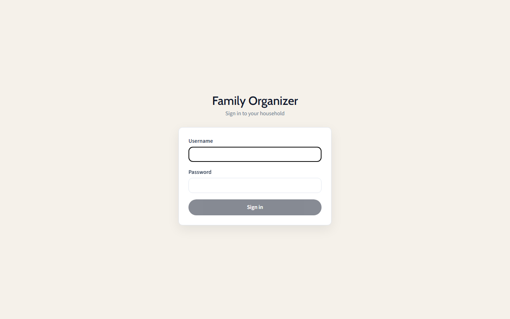 | 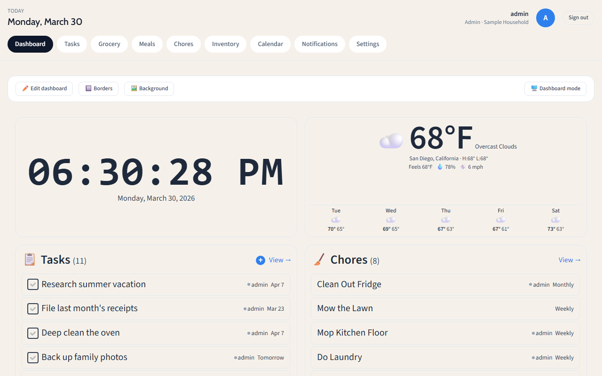 | 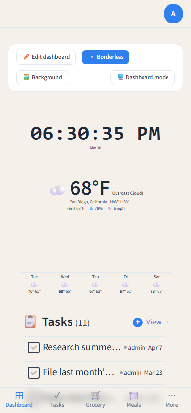 |

### Tasks · Chores · Grocery

| Tasks | Chores | Grocery |
|-------|--------|---------|
| 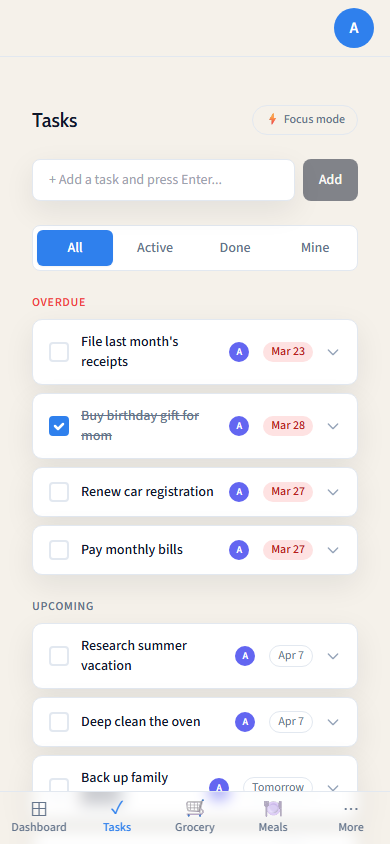 | 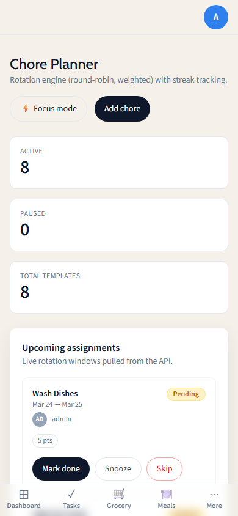 | 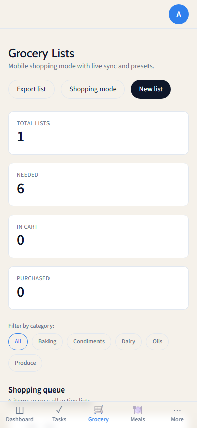 |

### Inventory · Meal Plans · Recipes

| Inventory | Meal Plans | Recipes |
|-----------|------------|---------|
| 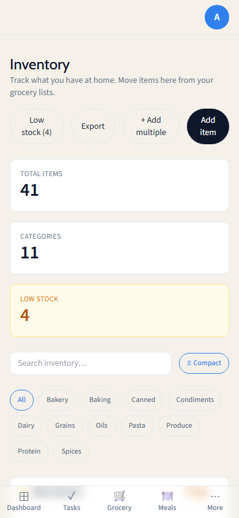 | 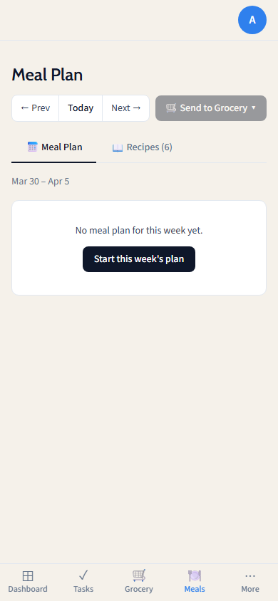 | 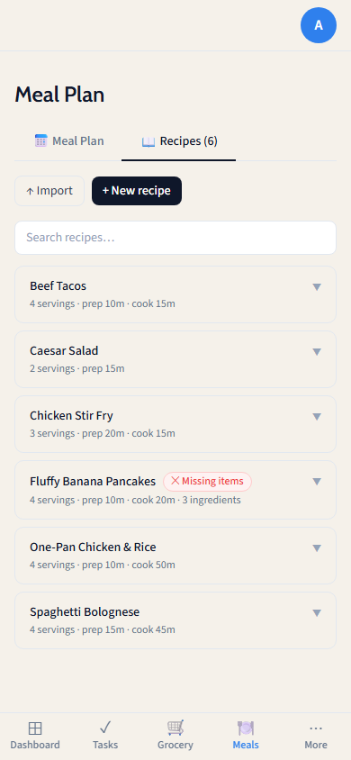 |

### Calendar · Settings

| Calendar (Week) | Calendar (Month) | Settings |
|-----------------|------------------|---------|
| 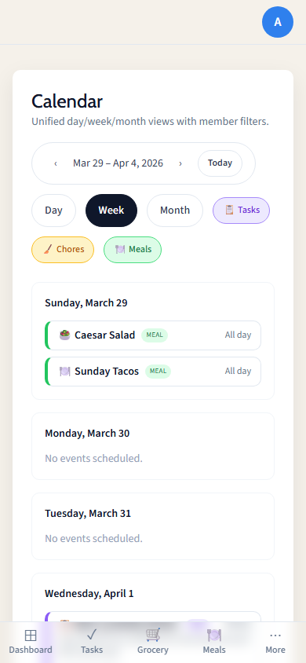 | 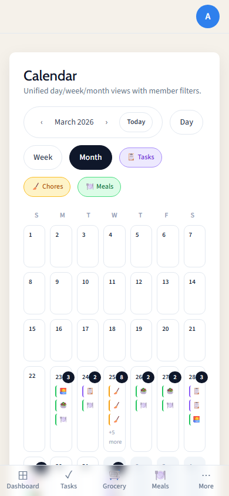 | 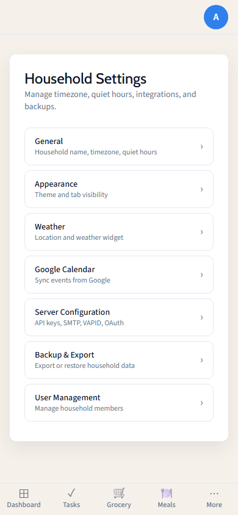 |

---

## Quick Start

```bash
git clone https://github.com/wadingthrulogs/family-organizer.git
cd family-organizer
chmod +x setup.sh
bash setup.sh
```


The wizard generates secrets, writes the root `.env` and `backend/.env`, and builds and starts the app.

**Windows users:** Run in WSL2.
**Default URL:** `http://localhost` (plain HTTP on port 80, or whatever `HTTP_PORT` you set). The setup wizard shows the exact URL.
**After setup:** The script displays the app URL and a direct link to `/register`. The **first account you register becomes the admin**; after that, public registration is closed and new users are added by an admin in **Settings**.
**Reconfigure:** Most settings (API keys, SMTP, push notifications, weather, Mapbox) can be changed via **Settings → Server Configuration** in the app (admin only).


Full guide: [docs/deployment.md](docs/deployment.md)

### Enable HTTPS with Tailscale (recommended)

After the initial setup, run the Tailscale setup script to get free, browser-trusted HTTPS on your local network — no port-forwarding or certificate management required:

```bash
bash tailscale-setup.sh
```

The script will:
1. Install Tailscale if not already present
2. Detect your MagicDNS hostname (e.g. `mymachine.tail411eff.ts.net`)
3. Issue a TLS certificate into `/etc/tailscale/certs/`
4. Write `TLS_HOSTNAME`, `APP_BASE_URL=https://<hostname>`, and `SESSION_SECURE=true` to your `.env` files and rebuild the containers — nginx switches to HTTPS automatically when it finds the certificate

Your app will be available at `https://<your-hostname>` when it finishes.

> **If you use Google Calendar:** after running the script, add your new HTTPS redirect URI in [Google Cloud Console](https://console.cloud.google.com) → APIs & Services → Credentials → your OAuth client → Authorised redirect URIs:
> ```
> https://<your-hostname>/api/v1/integrations/google/callback
> ```

See [Tailscale-guide.md](Tailscale-guide.md) or the [Tailscale HTTPS](#tailscale-https-recommended) section below for renewal, cron setup, and troubleshooting.

---

## Post-Setup Configuration

After the initial setup, most optional settings can be changed **directly in the app** without
editing files or restarting the server. Log in as an admin and go to **Settings**.

### Configurable via Settings UI (Admin → Server Configuration)

| Setting | UI Label |
|---------|----------|
| OpenWeatherMap API key | Weather → API Key |
| SMTP host, port, user, password, from address | Email → SMTP |
| Web push VAPID keys | Push Notifications → VAPID Keys |
| Google OAuth client ID & secret | Google Calendar → Credentials |
| Mapbox public token & home address | Commute → Mapbox Token / Home Address |
| App base URL | Server → App Base URL *(applies to CORS after `make restart`; for the Google OAuth callback set `APP_BASE_URL` in the root `.env` and `make up`)* |
| Task retention (auto-archive / hard-delete days) | Server → Task Retention |

Sensitive values (secrets, passwords, VAPID keys) are encrypted at rest in the database.
The UI shows a "configured" badge instead of revealing stored values.

### Configured in files

There are two env files. Both are written by `setup.sh`; edit them and run `make up` to apply (a plain `make restart` does **not** re-read env files).

**Root `.env`** — read by Docker Compose. Values here win over `backend/.env`.

| Variable | Purpose |
|----------|---------|
| `SESSION_SECRET` | Cookie signing key (≥16 chars) |
| `ENCRYPTION_KEY` | Encrypts secrets at rest — exactly 32 bytes (`openssl rand -base64 32`) |
| `APP_BASE_URL` | The URL people use to reach the app (CORS, OAuth callback) |
| `SESSION_SECURE` | `true` when served over HTTPS |
| `TZ` | Server timezone (affects digest / cleanup schedule) |
| `HTTP_PORT` / `HTTPS_PORT` | Host ports for nginx (default `80` / `443`). Accept `ip:port`, e.g. `HTTP_PORT=127.0.0.1:8080` when something else on the host owns :80 |
| `TLS_HOSTNAME` | Enables HTTPS using `/etc/tailscale/certs/<host>.crt` (set by `tailscale-setup.sh`) |
| `RECIPE_UPLOADS_HOST_DIR` / `RECIPE_OUTPUT_HOST_DIR` | Host folders shared with the recipe-photo watcher (default `~/uploads`, `~/recipe-output`) |
| `RECIPE_EXTRACT_TIMEOUT_MS` | How long a recipe-photo upload waits for the watcher (default `75000`) |

**`backend/.env`** — loaded into the backend container. Use it for optional integrations if you prefer files over the Settings UI:
`GOOGLE_CLIENT_ID`, `GOOGLE_CLIENT_SECRET`, `SMTP_*`, `PUSH_VAPID_PUBLIC_KEY`/`PUSH_VAPID_PRIVATE_KEY`, `OPENWEATHER_API_KEY`, and `WEBHOOK_URL` (webhook delivery is env-only — it has no Settings field). Values saved in the Settings UI override these.

The full list is in [docs/deployment.md](docs/deployment.md#environment-variable-reference).

---

## Common Commands

| Command | What it does |
|---------|-------------|
| `make setup` | Run setup wizard (first-time install or quick restart) |
| `make reconfigure` | Re-run setup wizard to change configuration |
| `make up` | Build and (re)create all containers — use after editing `.env` files or pulling code |
| `make down` | Stop and remove containers (data is preserved) |
| `make restart` | Restart containers without rebuilding (does not pick up `.env` changes) |
| `make logs` | Follow live logs |
| `make status` | Show container health |
| `make backup` | Save timestamped DB backup to `./backups/` |
| `make restore FILE=path` | Restore DB from backup |
| `make update` | Pull latest code and rebuild |
| `make shell-backend` | Open a shell inside the running backend container |
| `make tailscale-setup` | Set up Tailscale HTTPS (cert, env, rebuild) |
| `make tailscale-renew` | Renew Tailscale cert and reload nginx (no rebuild) |
| `make tailscale-cron` | Install the weekly cert-renewal cron job only |

---

## Google Calendar Integration (optional)

To sync Google Calendars, you need a free OAuth 2.0 client from Google Cloud.

### 1. Create a Google Cloud Project

1. Go to [console.cloud.google.com](https://console.cloud.google.com/)
2. Click the project dropdown (top-left) → **New Project**
3. Give it a name (e.g. `Family Organizer`) and click **Create**

### 2. Enable the Google Calendar API

1. In the left sidebar go to **APIs & Services → Library**
2. Search for **Google Calendar API** and click it
3. Click **Enable**

### 3. Create OAuth 2.0 Credentials

1. Go to **APIs & Services → Credentials**
2. Click **Create Credentials → OAuth client ID**
3. If prompted, configure the **OAuth consent screen** first:
   - User type: **External** → fill in app name and your email → save
4. Back on Create OAuth client ID:
   - Application type: **Web application**
   - Name: anything (e.g. `Family Organizer`)
   - Under **Authorised redirect URIs**, click **Add URI** and enter:
     ```
     <APP_BASE_URL>/api/v1/integrations/google/callback
     ```
     Replace `<APP_BASE_URL>` with your actual URL from setup.
     Examples:
     - `http://localhost/api/v1/integrations/google/callback` *(initial setup)*
     - `https://familyorganizer.tail411eff.ts.net/api/v1/integrations/google/callback` *(Tailscale HTTPS)*
5. Click **Create** — a dialog will show your **Client ID** and **Client Secret**

### 4. Add Test Users (Required while app is in Testing mode)

By default, Google keeps new OAuth apps in **Testing** mode. In this mode, only explicitly approved email addresses can complete the Google sign-in — anyone else will see an "Access blocked" error.

1. Go to **APIs & Services → OAuth consent screen**
2. Click the **Audience** tab (previously labelled "Test users")
3. Under **Test users**, click **+ Add Users**
4. Enter the Gmail address of each Google account you want to connect (e.g. the family calendar owner's address)
5. Click **Save**

> **Tip:** You need to add every Google account you plan to link in Family Organizer — not just your own. If a family member wants to sync their personal calendar, add their address here too.

You can leave the app in Testing mode indefinitely for personal/household use — there's no need to go through Google's verification process.

### 5. Add the Credentials

**Easiest:** log in as an admin → **Settings → Server Configuration → Google Calendar**, paste the Client ID and Client Secret, and save. No restart needed.

**Or** put them in `backend/.env`:

```env
GOOGLE_CLIENT_ID=your-client-id-here.apps.googleusercontent.com
GOOGLE_CLIENT_SECRET=your-client-secret-here
```

and apply with:

```bash
make up
```

`GOOGLE_REDIRECT_URL` can be left blank — it is derived from `APP_BASE_URL` at startup (`<APP_BASE_URL>/api/v1/integrations/google/callback`). If you change `APP_BASE_URL`, change it in the root `.env` and run `make up` so the redirect URL follows.

### 6. Connect Your Google Account

Log in to Family Organizer → **Settings → Google Calendar** → **Connect Google Account**.
After authorising, your calendars will appear under **Settings → Google Calendar** to enable sync. Calendars sync incrementally every 30 minutes (plus a nightly full refresh); use **Sync** (or **Sync All**) to pull immediately, or **Force full re-sync** to re-fetch everything and drop stale events.

---

## Importing Recipes

Open **Meal Plans → Recipes** and click **↑ Import**.

### Paste text

Paste one or more recipes separated by a blank line. The first line of each block is the title; the remaining lines are ingredients (quantity, unit, and name in any natural order).

```
Pasta Bolognese
500g beef mince
2 cans diced tomatoes
1 onion
2 cloves garlic

Chicken Stir Fry
2 chicken breasts
1 cup broccoli
2 tbsp soy sauce
1 tbsp sesame oil
```

### Upload JSON

Upload a `.json` file containing an array of recipe objects. All fields except `title` are optional. (The file is read in the browser and each recipe is created individually.)

```json
[
  {
    "title": "Pasta Bolognese",
    "description": "Classic Italian meat sauce",
    "servings": 4,
    "prepMinutes": 15,
    "cookMinutes": 45,
    "sourceUrl": "https://example.com/pasta-bolognese",
    "ingredients": [
      { "name": "beef mince", "quantity": 500, "unit": "g" },
      { "name": "diced tomatoes", "quantity": 2, "unit": "cans" },
      { "name": "onion", "quantity": 1 },
      { "name": "garlic", "quantity": 2, "unit": "cloves" }
    ]
  },
  {
    "title": "Chicken Stir Fry",
    "servings": 2,
    "cookMinutes": 20,
    "ingredients": [
      { "name": "chicken breasts", "quantity": 2 },
      { "name": "broccoli", "quantity": 1, "unit": "cup" },
      { "name": "soy sauce", "quantity": 2, "unit": "tbsp" }
    ]
  }
]
```

---

## Recipe Photo Import (optional, AI)

On the **Inventory** page, **Upload recipe photo** lets you take or choose a photo of a recipe or ingredient list. The app hands the photo to a small watcher service on the host that runs [Claude Code](https://claude.com/claude-code) in headless mode, gets back a list of items (name, quantity, unit, category), and shows them for you to edit before they're added to inventory.

- The app itself never calls an AI API or holds a key — it only drops the image into `RECIPE_UPLOADS_HOST_DIR` and waits (up to `RECIPE_EXTRACT_TIMEOUT_MS`) for a JSON result in `RECIPE_OUTPUT_HOST_DIR`.
- Without the watcher, the button returns "extraction not configured" and nothing else is affected.
- Setup (systemd unit, subscription-only billing guard): [tools/recipe-image-watcher/README.md](tools/recipe-image-watcher/README.md).

---

## Tailscale HTTPS (Recommended)

Tailscale issues free, browser-trusted TLS certificates for any machine on your tailnet — no
Certbot, no Let's Encrypt, no port-forwarding needed. HTTPS is required for secure session
cookies and browser push notifications.

### What `tailscale-setup.sh` does automatically

Run it from the repo root:

```bash
bash tailscale-setup.sh
```

The script handles everything in order:

1. **Installs Tailscale** on the host if not already installed (Linux/macOS/WSL2) and walks you through `tailscale up` if needed
2. **Detects your Tailscale MagicDNS hostname** (e.g. `mymachine.tail411eff.ts.net`) from `tailscale status`
3. **Issues a TLS certificate** via `tailscale cert` (asks for `sudo`) and saves it to `/etc/tailscale/certs/`
4. **Updates `.env` and `backend/.env`** — sets `TLS_HOSTNAME=<hostname>`, `APP_BASE_URL=https://<hostname>`, and `SESSION_SECURE=true`
5. **Rebuilds and restarts containers** (`make up`). On start, the nginx container sees the certificate and serves HTTPS on 443; port 80 redirects to HTTPS
6. **Polls the health endpoint** until the app responds
7. **Optionally installs a weekly cron** (in root's crontab) to renew the certificate and reload nginx without downtime

Nothing in the repo is modified — HTTPS is purely driven by `.env` plus the certificate on disk.

After the script finishes, open `https://<your-hostname>` — you should see the padlock.

### What you still need to do manually

**If you use Google Calendar**, update your OAuth redirect URI in Google Cloud Console:

1. Go to [console.cloud.google.com](https://console.cloud.google.com) → **APIs & Services → Credentials**
2. Click your OAuth client → **Authorised redirect URIs**
3. Add:
   ```
   https://<your-hostname>/api/v1/integrations/google/callback
   ```
4. Click **Save**

> **Tip:** Open **Settings → Server Configuration** in the app — the Google OAuth section shows the exact URIs you need to register, pre-filled with your current `APP_BASE_URL`.

### Re-running and renewal

```bash
bash tailscale-setup.sh --renew   # Re-issue cert + reload nginx (no rebuild)   — or: make tailscale-renew
bash tailscale-setup.sh --cron    # Install/update the weekly renewal cron only — or: make tailscale-cron
```

Quick-start runs of `bash setup.sh` update the root `.env` in place, so your Tailscale settings (`TLS_HOSTNAME`, `APP_BASE_URL`, `SESSION_SECURE`) and any other overrides are preserved. `make reconfigure` re-runs the full wizard and resets `APP_BASE_URL`/`SESSION_SECURE` to plain-HTTP defaults — re-run `tailscale-setup.sh` afterwards.

To go back to plain HTTP: remove `TLS_HOSTNAME` from `.env`, move the certificate pair out of `/etc/tailscale/certs/` (nginx auto-detects a single cert there), set `APP_BASE_URL=http://…` and `SESSION_SECURE=false`, then `make up`. See [Tailscale-guide.md](Tailscale-guide.md).


---

## Development

```bash
# Backend (port 3000)
cd backend
cp .env.example .env
npm install
npx prisma migrate dev
npm run dev

# Frontend (port 80, Vite dev server) — separate terminal
cd frontend
npm install
npm run dev
```

> **Note:** The Vite dev server listens on port **80** (`frontend/vite.config.ts`), the same port the Docker stack uses — stop the containers first (`make down`) or change the port in `vite.config.ts`.
>
> Port 80 is privileged: on Linux/Raspberry Pi run with `sudo` or grant Node the capability (`sudo setcap cap_net_bind_service=+ep $(which node)`); on Windows run the terminal as Administrator. Otherwise `npm run dev` fails with `EACCES`.

The Vite dev server proxies `/api` (and `/ws`) to `http://localhost:3000` automatically.

Tests: `cd backend && npm test` (Vitest + Supertest), and end-to-end browser tests in [`e2e/`](e2e/README.md) (Playwright). See [CONTRIBUTING.md](CONTRIBUTING.md).

---

## Tech Stack

| Layer | Technology |
|-------|-----------|
| Backend | Node 20, TypeScript, Express 4, Prisma 5, SQLite (WAL), Zod |
| Auth | express-session (SQLite store), bcrypt |
| Frontend | React 18, TypeScript, Vite 5, Tailwind CSS 3 |
| Data fetching | TanStack Query v5, Axios |
| Dashboard grid | react-grid-layout v2 |
| Maps | mapbox-gl (commute widget) |
| Notifications | web-push, Nodemailer, webhooks |
| Deployment | Docker Compose, nginx 1.27 (HTTP, or HTTPS with a Tailscale cert) |
| Tooling | Vitest, Playwright, MCP server (`mcp/`), Claude Code watcher (`tools/`) |

---

## Documentation

| Doc | Description |
|-----|-------------|
| [docs/deployment.md](docs/deployment.md) | Full deployment guide — Docker, reverse proxy, env vars, backups |
| [docs/architecture.md](docs/architecture.md) | System architecture overview |
| [docs/api.md](docs/api.md) | API endpoint reference |
| [docs/data-model.md](docs/data-model.md) | Database schema and entity relationships |
| [docs/requirements.md](docs/requirements.md) | Functional and non-functional requirements |
| [docs/release-checklist.md](docs/release-checklist.md) | Release and deployment runbook |
| [docs/perf-audit-2026-04.md](docs/perf-audit-2026-04.md) | Performance audit findings and fixes |
| [docs/ui-wireframes.md](docs/ui-wireframes.md) | UI wireframes and design notes |
| [Tailscale-guide.md](Tailscale-guide.md) | HTTPS setup via Tailscale — certs, renewal, Google OAuth fix |
| [mcp/README.md](mcp/README.md) | MCP server — let AI assistants use the organizer |
| [tools/recipe-image-watcher/README.md](tools/recipe-image-watcher/README.md) | Host watcher for recipe-photo import |
| [agents/README.md](agents/README.md) | Claude Agent SDK helper agents for frontend/dashboard work |
| [e2e/README.md](e2e/README.md) | Playwright end-to-end tests |
| [SECURITY.md](SECURITY.md) | Security policy and hardening notes |
| [CONTRIBUTING.md](CONTRIBUTING.md) | How to contribute |
| [CHANGELOG.md](CHANGELOG.md) | Release history |

---

## License

[MIT](LICENSE)
